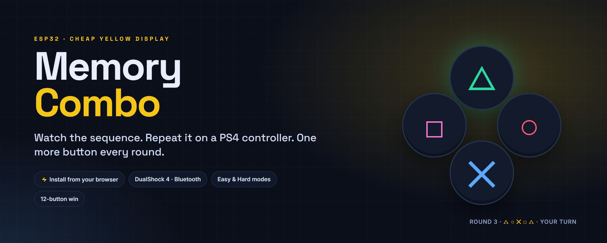
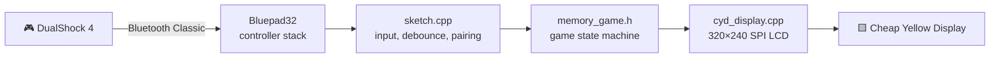

<p align="center">
  
</p>

<p align="center">
  <a href="https://marwane-haddane.github.io/cyd-ps4-memory-game/"></a>
  <a href="https://github.com/Marwane-Haddane/cyd-ps4-memory-game/releases/latest"></a>
</p>
<p align="center">
  
  
  
  
  
  
</p>
<p align="center">
  <a href="#install-in-one-minute">Install</a> ·
  <a href="#how-to-play">How to play</a> ·
  <a href="#release-files">Release files</a> ·
  <a href="#how-it-works">How it works</a> ·
  <a href="#build-from-source">Build</a> ·
  <a href="#troubleshooting">Troubleshooting</a>
</p>

---

## Memory Combo in one minute

The CYD flashes a sequence of PlayStation buttons — **△ ○ ✕ □**, and in Hard mode **L1 R1 L2 R2** too. You repeat it on a real **DualShock 4** connected over Bluetooth. Get it right and the next round adds one more button. Reach **12** and you win.

No phone app, no PC once it's flashed: just the board, a USB power source and the controller.

## Install in one minute

**[⚡ Open the web installer](https://marwane-haddane.github.io/cyd-ps4-memory-game/)** in Chrome or Edge on a computer.

1. Plug the CYD into your computer with a **USB data cable**.
2. Click **Install on my CYD**, pick its serial port and confirm.
3. When it finishes, press **RESET** on the board.

That's it: the same one-click flow as ESP32 Marauder or Bruce, powered by [ESP Web Tools](https://esphome.github.io/esp-web-tools/). No Arduino IDE or PlatformIO needed.

<details>
<summary><b>Install with esptool instead</b></summary>

Download `cyd-memory-game-v1.0.0-merged.bin` from the [latest release](https://github.com/Marwane-Haddane/cyd-ps4-memory-game/releases/latest), then:

```bash
pip install esptool
esptool --chip esp32 --baud 460800 write-flash 0x0 cyd-memory-game-v1.0.0-merged.bin
```

Or flash the separate parts:

```bash
esptool --chip esp32 --baud 460800 write-flash \
  0x1000 bootloader.bin 0x8000 partitions.bin 0x10000 firmware.bin
```

</details>

## Pair the controller

1. Keep the PS4 controller's USB cable **unplugged** — it talks to the CYD directly over Bluetooth.
2. Hold **SHARE**, then also hold **PS** until the light bar flashes.
3. The screen moves from pairing instructions to **CHOOSE YOUR GAME**.

Pairing keys are kept across restarts: after a power cycle, just press **PS** to reconnect. A second controller can't interfere with the first player's game.

## How to play

1. Release all buttons, choose **Easy** or **Hard** with the D-pad and press **✕**.
2. **WATCH AND REMEMBER** — the sequence plays on screen. Presses during playback are ignored.
3. **YOUR TURN** — press the buttons in the same order, one at a time, releasing between presses.
4. **ROUND CLEAR** — press ✕ to continue; the same sequence comes back with one new button.
5. A wrong button, two buttons at once, or a Hard-mode timeout shows **TRY AGAIN**. Finish 12 buttons for **YOU WIN**.

| Mode | Buttons in play | First round | Flash / gap | Time per press |
| --- | --- | --- | --- | --- |
| **Easy** | ✕ ○ □ △ | 2 | 750 / 250 ms | No limit |
| **Hard** | ✕ ○ □ △ + L1 R1 L2 R2 | 4 | 350 / 180 ms | 5 seconds |

## Release files

Every release is published by [GitHub Actions](.github/workflows/release.yml) with checksums verified.

| File | Flash at | Use |
| --- | --- | --- |
| `cyd-memory-game-vX.Y.Z-merged.bin` | `0x0` | Everything in one image — recommended |
| `bootloader.bin` | `0x1000` | Second-stage bootloader |
| `partitions.bin` | `0x8000` | Partition table (factory app, 1 MB) |
| `firmware.bin` | `0x10000` | Game application |
| `SHA256SUMS.txt` | — | SHA-256 of every file |

**Target:** original ESP32 CYD (ESP32-2432S028 family), 4 MB flash, DIO, 40 MHz. ESP32-S3/C3/C6 boards won't work: the DualShock 4 needs **Bluetooth Classic**, which only the original ESP32 has.

## How it works



| File | Responsibility |
| --- | --- |
| [`main/sketch.cpp`](main/sketch.cpp) | Bluetooth pairing, controller input, trigger thresholds, difficulty menu, playback timing |
| [`main/memory_game.h`](main/memory_game.h) | The game rules as a self-contained state machine: menu → ready → watch → repeat → result |
| [`main/cyd_display.cpp`](main/cyd_display.cpp) | CYD backlight and ST7789/ILI9341-class LCD driver over `esp_lcd`, landscape 320×240 UI |
| [`tests/memory_game_test.cpp`](tests/memory_game_test.cpp) | Behavior tests compiled against the same game logic |

**Fair input handling:** triggers use separate press/release thresholds to avoid jitter, a held button counts once, two buttons at once count as a mistake, and the game waits for the controller's first input report and for all buttons to be released before a round starts.

## Build from source

Built with **PlatformIO**, ESP-IDF 5.4.2, Arduino-ESP32 3.2.1 and [Bluepad32](https://github.com/ricardoquesada/bluepad32).

```bash
git clone https://github.com/Marwane-Haddane/cyd-ps4-memory-game.git
cd cyd-ps4-memory-game
git clone --depth 1 https://github.com/espressif/arduino-esp32.git components/arduino
```

1. In `platformio.ini`, set `build_dir` to a path **without spaces** (an ESP-IDF requirement), or delete that line if your project path has no spaces.
2. Open the folder in VS Code with PlatformIO → **Build** → **Upload** → **Monitor** at 115200 baud.
3. Known-good tool versions are pinned in [`requirements-build.txt`](requirements-build.txt).

Full step-by-step notes, serial-monitor checks and tool-version details: [CYD_STEPS.md](CYD_STEPS.md).

### Publish a new firmware version

1. Build, then copy `bootloader.bin`, `partitions.bin` and `firmware.bin` from `.pio/build/esp32dev/` into [`docs/firmware/`](docs/firmware).
2. Create the merged image and checksums:

   ```bash
   cd docs/firmware
   esptool --chip esp32 merge-bin -o cyd-memory-game-v1.1.0-merged.bin \
     --flash-mode dio --flash-freq 40m --flash-size 4MB \
     0x1000 bootloader.bin 0x8000 partitions.bin 0x10000 firmware.bin
   sha256sum *.bin > SHA256SUMS.txt
   ```

3. Point [`docs/manifest.json`](docs/manifest.json) at the new file and bump its `version`.
4. Commit, then tag: `git tag v1.1.0 && git push origin main v1.1.0`. The release and the web installer update automatically.

## Troubleshooting

| Problem | Fix |
| --- | --- |
| No serial port in the installer | Use a data cable; install the **CH340** or **CP210x** driver; try another USB port |
| Installer says the browser isn't supported | Use desktop **Chrome** or **Edge** (Web Serial); Firefox and Safari can't flash |
| Flash fails midway | Hold **BOOT** while clicking Install, release when writing starts |
| Controller won't pair | Unplug its USB cable, hold **SHARE + PS** until the bar flashes, press **RESET** on the CYD |
| Screen stays blank | Press **RESET**; check the board is an original-ESP32 CYD with 4 MB flash |

## Status

The firmware compiles cleanly and the game logic passes its behavior tests. Controller pairing and every button event were confirmed on real hardware (ESP32-D0WD-V3 with a DualShock 4). The full game on the CYD screen still needs broader testing across CYD board revisions — please open an issue if your board behaves differently.

## Credits

- Based on the [esp-idf-arduino-bluepad32-template](https://github.com/ricardoquesada/esp-idf-arduino-bluepad32-template) by Ricardo Quesada (Apache-2.0, see [LICENSE](LICENSE)).
- Controller stack: [Bluepad32](https://github.com/ricardoquesada/bluepad32).
- Web installer: [ESP Web Tools](https://esphome.github.io/esp-web-tools/) by ESPHome.

---

<p align="center">Built by <strong>Marwane Haddane</strong> · also in <a href="https://github.com/Marwane-Haddane/Robotics-X-RoboGenius">Robotics-X RoboGenius</a></p>
